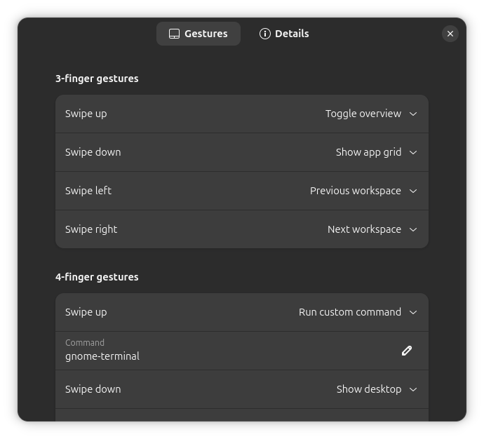
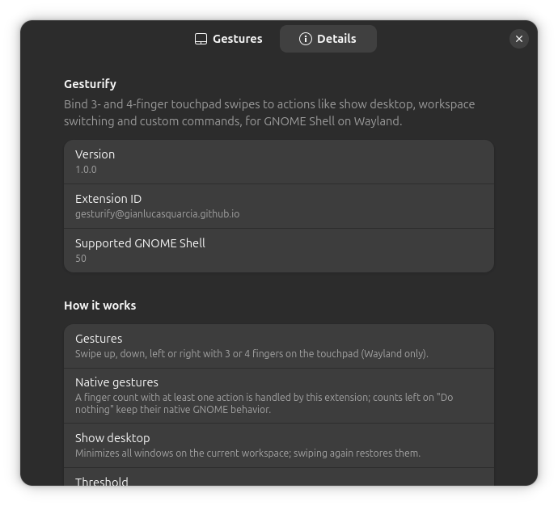

<div align="center">

# 🖐️ Gesturify

**Make your touchpad do more: 3- and 4-finger swipes for GNOME.**

Bind 3- and 4-finger touchpad swipes to actions like show desktop, workspace switching and custom commands, for GNOME Shell on Wayland.





</div>

## ✨ Features

- 3- and 4-finger swipes in all four directions (up / down / left / right)
- Per-gesture actions, configured from a native GTK4/libadwaita preferences window
- Adjustable swipe threshold
- Native GNOME gestures keep working for any finger count you leave untouched
- Built-in **Details** page explaining version, behavior and available actions

## 🎯 Actions

| Action | What it does |
| --- | --- |
| Show desktop | Minimizes the windows on the current workspace; swiping again restores them |
| Previous / Next workspace | Switches workspace |
| Toggle overview | Opens/closes the Activities overview |
| Show app grid | Opens the applications grid |
| Run custom command | Runs any shell command you type |
| Do nothing | Leaves the gesture unbound |

**Default:** 4-finger swipe down → Show desktop. Everything else is unbound.

## 📦 Installation

```bash
git clone https://github.com/gianlucasquarcia/Gesturify.git && cd Gesturify
make install                      # copies to ~/.local/share/gnome-shell/extensions
# log out and back in (Wayland), then:
gnome-extensions enable gesturify@gianlucasquarcia.github.io
```

Open the settings with `gnome-extensions prefs gesturify@gianlucasquarcia.github.io` (or from the Extensions app).
`make pack` builds `gesturify@gianlucasquarcia.github.io.shell-extension.zip`, which can be installed with
`gnome-extensions install --force <zip>` or uploaded to [extensions.gnome.org](https://extensions.gnome.org/).

## ⚠️ Notes & limitations

- **Wayland only** – touchpad swipe events aren't available on X11.
- If a finger count has **any** action bound, this extension captures **all** its swipes
  (overriding GNOME's native gesture for that count). Counts with every direction on
  "Do nothing" stay native.
- GNOME Shell 51 support is declared but only tested on 50.
- The Extension Manager app's *Details* button queries extensions.gnome.org and shows an error
  for extensions that aren't published there. Use Gesturify's own Details page instead.

## 🧪 Tests

- `npm test` – unit tests (Node ≥ 20, no dependencies). GJS/Shell modules are mocked via
  `tests/loader.mjs` and `tests/mocks/`; covers the engine, actions, `extension.js`, `prefs.js`
  and the GSettings schema (needs `gjs` and `glib-compile-schemas`).
- `npm run test:integration` – runs the real extension in an isolated headless GNOME Shell with
  real Wayland windows (needs `gnome-shell`, `dbus-daemon`, `gnome-text-editor`). Touchpad events
  are synthesized by a test-only helper extension; your settings are untouched.

## 🖼️ Regenerating screenshots

```bash
SHOT=preferences npm run screenshots
SHOT=details npm run screenshots
```

Rendered from the real prefs window in an isolated headless GNOME Shell.

## 🤝 Contributing

Issues and pull requests are welcome. Please run `npm test` (and `npm run test:integration` if you touch
gesture handling) before opening a PR.

## 📄 License

[GPL-3.0-or-later](LICENSE) © 2026 [Gianluca Squarcia](https://github.com/gianlucasquarcia)
